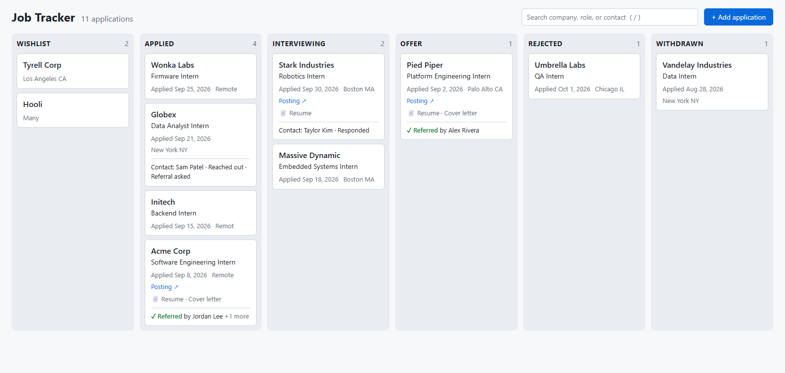
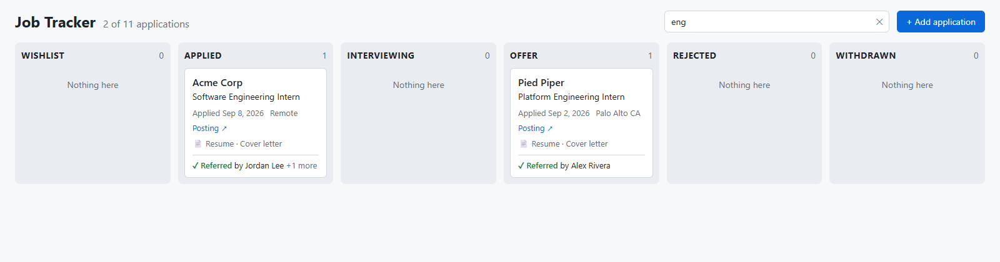
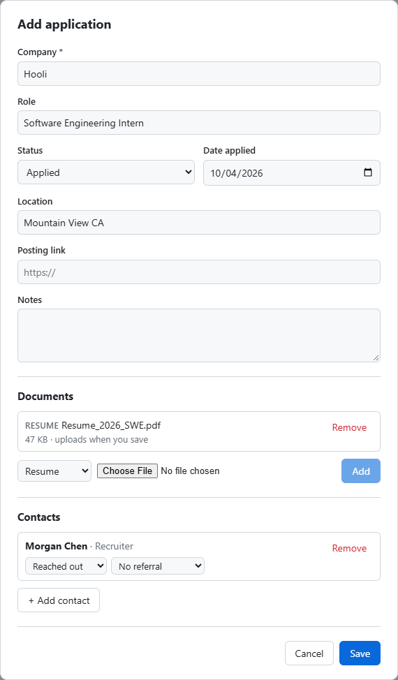
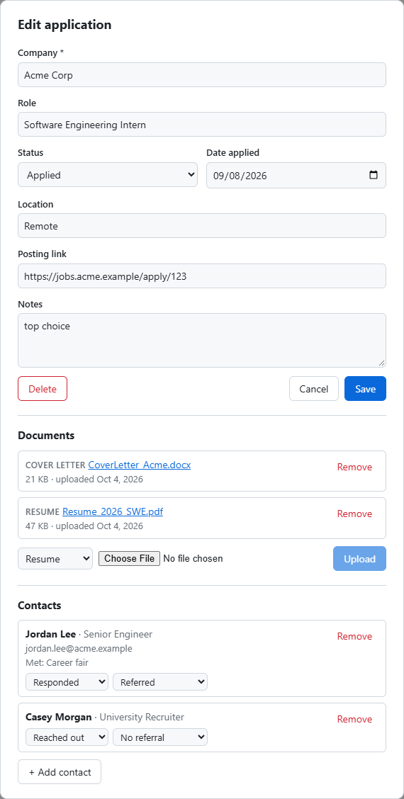
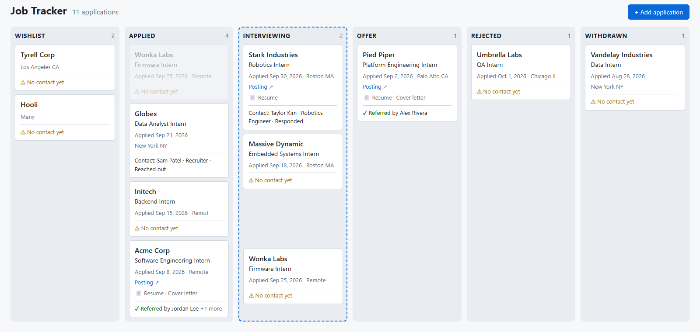
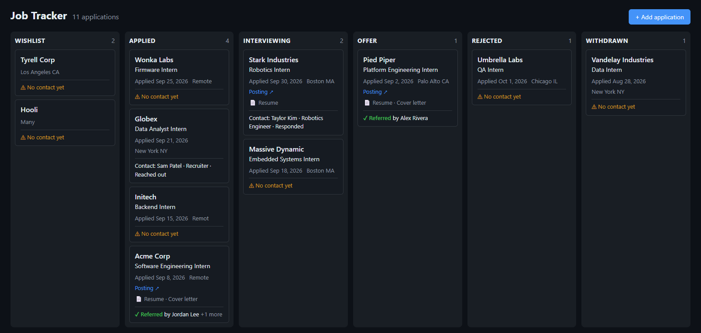

# Job Tracker

A personal job application tracker that replaced my spreadsheet. Applications live on a drag-and-drop board, each one keeps the people I've talked to (and whether they referred me), and the exact resume and cover letter I sent are attached to it.

Built with **TypeScript, Node.js, Express, SQLite, React, and Docker**, one stage at a time (see [ROADMAP.md](ROADMAP.md)).



*All screenshots use made-up sample data.*

## Features

- **Status board.** Six columns (Wishlist, Applied, Interviewing, Offer, Rejected, Withdrawn). Drag a card to change its status; it saves immediately and rolls back if the save fails. Works with the keyboard too (Tab to a card, Space to pick up, arrows to move, Space to drop).
- **Search.** Type part of a company, role, or contact's name and the board filters as you type, so you can see at a glance whether (and where) you've applied somewhere. Press `/` to jump to the search box and Esc to clear it. If nothing matches, one click adds it as a new application with the company filled in.
- **Add an application in one step.** The Add form takes the job details plus, optionally, your resume, cover letter, and contacts; one Save creates them all. If a file or contact fails to save, the application is kept and reopened so you can retry just that part.
- **Edit and delete applications** in a form that shows the server's validation messages next to the field they belong to.
- **Contacts and referrals.** Track who you've reached out to and whether they've referred you. Cards show **✓ Referred by …**, or the contact's name and whether they've responded.
- **Documents.** Attach the resume and cover letter (PDF or DOCX, up to 10 MB) you used for each application. PDFs open in the browser; DOCX files download.
- **CSV import.** Load an exported spreadsheet. Messy rows (bad dates, unknown statuses, duplicates) are skipped with a reason, and the import can be re-run safely.
- **Light and dark mode**, following your system setting.
- **Paste to add:** Paste a job posting's link or description, and the form fills in the job details for you to review before saving.
- **Automated wishlist:** A scheduled Claude task searches for new postings twice a week, fills in location, work mode, and skills, and adds matches to the Wishlist through the API.



| Adding an application | Editing an application |
|---|---|
|  |  |





## Running it

### With Docker (recommended)

Requires [Docker Desktop](https://www.docker.com/products/docker-desktop/).

```sh
docker compose up -d --build
```

Then open **http://localhost:3000**. The container restarts automatically whenever Docker Desktop is running.

Your data stays on your machine in `data/` (the SQLite database and uploaded documents). It's mounted into the container, so it survives rebuilds, and it's gitignored.

| Command | What it does |
|---|---|
| `docker compose up -d --build` | Build and start (rebuild after changing code) |
| `docker compose stop` | Stop it |
| `docker compose logs -f` | Watch the server's output |

### For development

Requires Node.js 24.

```sh
npm install
cp .env.example .env
npm run dev                 # API on http://localhost:3000, restarts on save

cd web
npm install
npm run dev                 # board on http://localhost:5173, updates on save
```

Open http://localhost:5173. The Vite dev server forwards API requests to port 3000. Stop the Docker container first (`docker compose stop`), since both use port 3000.

| Script (project root) | What it does |
|---|---|
| `npm run dev` | Run the API with reload on save |
| `npm run typecheck` | Type-check without building |
| `npm run build` / `npm start` | Compile to `dist/` and run the compiled API |

## Importing a spreadsheet

Export your spreadsheet as CSV, then send it to the import endpoint:

```sh
curl -X POST http://localhost:3000/import -H "Content-Type: text/csv" --data-binary "@tracker.csv"
```

```json
{
  "imported": 6,
  "skipped": [
    { "row": 18, "reason": "unrecognized date \"Sept 5\" (expected M/D/YY, M/D/YYYY, or YYYY-MM-DD)" },
    { "row": 19, "reason": "unknown status \"Ghosted\"" }
  ]
}
```

The importer looks for a header row containing **Company**, so a title or summary block above it is fine. It reads the columns `Company`, `Position`, `Date Applied` (`9/8/26`, `9/21/2026`, or `2026-09-08`), `Application Status`, `Details`, `Location`, and `Applicant Portal`. Rows already in the database (same company and role) are skipped, so re-importing only adds new ones. See [`samples/sample.csv`](samples/sample.csv) for an example with deliberately messy rows.

## API

JSON in and out. Validation errors return `400` with a list of `{ field, message }`.

| Method & path | What it does |
|---|---|
| `GET /applications` | List applications with their contacts and documents. Optional `?status=` and `?company=` (partial match) |
| `POST /applications` | Create an application (`company` is required) |
| `GET /applications/:id` | One application with its contacts and documents |
| `PATCH /applications/:id` | Update only the fields sent |
| `DELETE /applications/:id` | Delete it, along with its contacts and document files |
| `POST /applications/:id/contacts` | Add a contact |
| `PATCH /contacts/:id` · `DELETE /contacts/:id` | Update or remove a contact |
| `POST /applications/:id/documents` | Upload a document (`multipart/form-data` with `file` and `kind`: `resume`, `cover_letter`, or `other`) |
| `GET /documents/:id` · `DELETE /documents/:id` | Open or delete a document |
| `POST /import` | Import a CSV (`Content-Type: text/csv`) |
| `GET /health` | Health check |

## How it's built

| Layer | Choices |
|---|---|
| API | Node.js, Express 5, TypeScript, [zod](https://zod.dev) for request validation |
| Database | SQLite via better-sqlite3, **raw SQL, no ORM**. `CHECK` constraints on statuses and ISO dates, foreign keys with `ON DELETE CASCADE` |
| Uploads | multer; files saved under random UUID names, never the uploaded filename |
| Frontend | React 19, Vite, TypeScript, [dnd-kit](https://dndkit.com) for drag and drop, plain CSS |
| Packaging | Multi-stage Dockerfile (build API → build board → small runtime image running as a non-root user), Docker Compose |

```
src/                      the API
├─ index.ts               starts the server
├─ app.ts                 Express app: middleware and routes
├─ db/                    schema.sql and the SQLite connection
├─ applications/          each feature has the same three layers:
├─ contacts/                *.schema.ts      validation rules and types (zod)
├─ documents/               *.repository.ts  the only place with SQL
├─ import/                  *.routes.ts      HTTP: validate, call the repository, respond
└─ middleware/            turns errors into JSON 400/404/500 responses
web/src/                  the board (React)
├─ App.tsx                owns the application list; everything else gets it as props
├─ api.ts                 every call to the API
└─ components/            Board, Column, ApplicationCard, ApplicationDialog, ContactsSection, DocumentsSection
```

A few decisions worth noting:

- **"Need to find a contact" is a query, not a status.** The old spreadsheet had it as a status. Here it's simply an application with no contacts, so nothing has to be kept up to date by hand.
- **Adding with attachments is several requests, not one.** Files and contacts need the application's id, so the Add form holds them as drafts, creates the application, then uploads and creates each one. A failure partway keeps what succeeded and reports the rest.
- **Dates are stored as ISO `YYYY-MM-DD` text**, which sorts correctly and avoids time-zone shifts (the board formats them itself instead of using `new Date()`).
- **No N+1 queries.** The board's list loads every contact and document in one query each and groups them in code, rather than one query per application.

## Privacy

Everything stays local. The database, uploaded resumes and cover letters, `.env`, and any `tracker.csv` export are gitignored and excluded from the Docker image. Only the fake [`samples/sample.csv`](samples/sample.csv) is in the repository.
